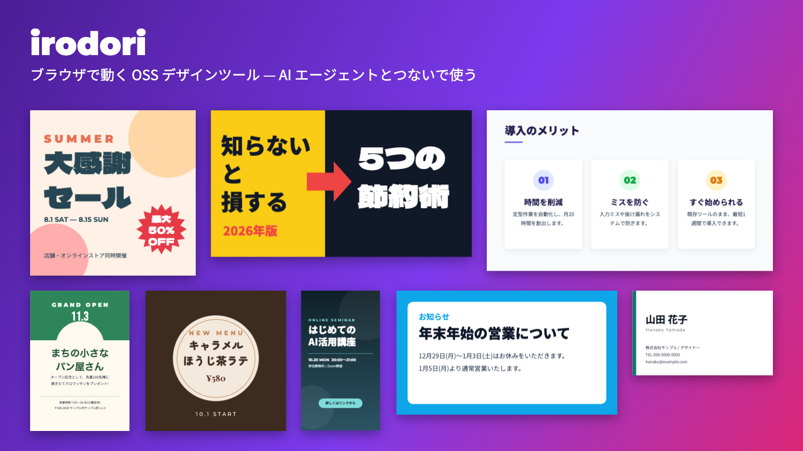

# irodori

[English](README.en.md) | 日本語

**自分の AI エージェント(Claude Code / Cursor / Claude Desktop など)とつなぐと、Canva Pro 相当の作業を「AI のサブスク料の範囲」で賄える、ブラウザで動くデザインツール。**

SNS 画像・チラシ・名刺・サムネイル・スライドなどを、ブラウザ上のエディタで作れます。デザインは JSON なので、AI エージェントが文章とレイアウトを直接書き、画面に即反映されます。ログイン不要・アカウント不要で使え、データは自分の端末(またはローカルのフォルダ)に残ります。

- デモ: https://irodori.unmei-bunkiten.workers.dev (ログイン・クラウド保存は止めた公開デモ)
- ライセンス: [MIT](LICENSE)



> 注: irodori は Canva とは無関係の独立したプロジェクトです。「Canva」は Canva Pty Ltd の商標で、比較の説明のために名前を挙げているだけです。

## できること

実装を読んで確認した範囲の機能です。

**エディタ**
- 図形・テキスト・画像・アイコン・グラフ・表・QR コードを配置。グループ化、複製、配置、左右/上下反転、透明度、影、取り消し/やり直し
- テキスト: 日本語フォント(Google Fonts)、縁取り・背景色・文字間隔/行間・箇条書き、曲げ文字、**縦書き**(縦中横・約物の回転を含む自作実装)
- 画像: トリミング、調整、角丸、フレームへのはめ込み、差し替え
- 複数ページ、サイズプリセット(SNS・スライド・印刷・Web など)、**マジックリサイズ**(別サイズへ作り直し)
- ブランドキット(色・フォント・ロゴを登録して使い回す。この端末の IndexedDB に保存)
- バージョン履歴(この端末に最大 30 件)
- アニメーション(ページ内の登場アニメ)とプレゼン表示
- テンプレート: すべてこのプロジェクトのオリジナル(Instagram・ストーリー・YouTube・X・LINE・チラシ・カード・Web・スライドなど)

**書き出し**
- PNG(透過可)・JPG・PDF(印刷サイズ指定あり)・SVG・動画(ブラウザが対応していれば MP4、無ければ WebM)

**素材**
- アイコン・絵文字 約 2.9 万点(10 セット。ライセンスは下記)
- 写真検索(Openverse の CC0/PDM、Picsum。サーバー版でキーを設定すれば Unsplash / Pexels も)
- **背景除去**: ブラウザ内で AI モデルを動かす(サーバーに画像を送らない。初回にモデルをダウンロード、WebGPU で約 98MB / WASM で約 192MB)

**HTML スライド(slide-studio 取り込み)**
- 台本から Claude Code などでスライドを作り、ブラウザで直す。発表者ツール・メモ・PDF 付き。`public/slides/` に同梱

**AI エージェント連携(ローカル版)**
- `npm run agent` で起動するローカルサーバーが `designs/` フォルダの JSON をデザインとして扱う。AI がファイルを書き換えると開いている画面に即反映(詳細は [AGENTS.md](AGENTS.md))

**Cloudflare 版(任意)**
- パスキー / Google ログイン、クラウド保存(D1 + R2)、共有リンク、写真検索の中継。自分の Cloudflare アカウントに置く([docs/self-hosting.md](docs/self-hosting.md))

## クイックスタート

Node.js は Vite 8 の要件に合わせて `^20.19` または `>=22.12`、Cloudflare 版のデプロイ(wrangler)には 22 以上が必要です(いずれも各パッケージの `engines` 記載による)。

### ① ブラウザだけで使う

```bash
npm i
npm run dev
```

表示された URL を開きます。デザインはこの端末のブラウザ(IndexedDB)に保存されます。

### ② AI エージェントとつなぐ

```bash
npm i
npm run agent        # ビルドしてから http://127.0.0.1:4600 で起動(ポートは --port または PORT で変更)
```

カレントディレクトリの `designs/` に JSON を置く/書き換えると画面に反映されます。エージェント側の設定(JSON の書き方、MCP サーバーなど)は **[AGENTS.md](AGENTS.md) を参照**してください。

### ③ Cloudflare に自分で置く(任意)

ログイン・クラウド保存・共有が必要な場合のみ。概要:

```bash
cp wrangler.example.jsonc wrangler.jsonc   # account_id / database_id を自分のものに
npx wrangler d1 create irodori
npx wrangler r2 bucket create irodori
npx wrangler d1 migrations apply irodori --remote
npm run build && npx wrangler deploy
# 任意:
npx wrangler secret put GOOGLE_CLIENT_ID
npx wrangler secret put GOOGLE_CLIENT_SECRET
npx wrangler secret put UNSPLASH_ACCESS_KEY
npx wrangler secret put PEXELS_API_KEY
```

詳しい手順は **[docs/self-hosting.md](docs/self-hosting.md)**。

## Canva Pro と比べて

「Canva Pro の代わりに全部できる」わけではありません。向き・不向きを正直に書きます(Canva 側の機能・料金は変わるため、比較は一般的な傾向であり、最新の内容は各社の公式情報で確認してください)。

| 区分 | 内容 |
| --- | --- |
| **AI のサブスクで賄えるもの** | 文章・コピー・デザイン案の生成(AI が JSON を書く)、既存デザインの文言差し替え・色違い・サイズ違いの量産、スライドの台本→構成。追加のサービス料は不要で、手持ちの AI エージェントの契約内で動く |
| **AI 無しでもブラウザ内で無料のもの** | 背景除去(ブラウザ内 AI モデル)、マジックリサイズ、ブランドキット、透過 PNG、SVG・PDF 書き出し、動画書き出し、縦書き、バージョン履歴、アニメーション、QR コード、グラフ・表 |
| **賄えないもの** | **画像生成**(Claude は画像を生成しません。必要なら別の画像生成サービスで作った画像を取り込む)、プレミアム素材の量(写真・動画・音楽・テンプレートは Canva に及ばない)、リアルタイム共同編集、モバイルアプリ、Canva 形式のファイルの読み込み、他の Canva 固有機能 |

## 素材とライセンス

- **テンプレート**: すべてこのプロジェクトのオリジナルです。
- **アイコン・絵文字**: MIT / ISC / Apache-2.0 のセットのみ採用(`scripts/build-icons.mjs` が許可リスト外のライセンスを拒否します)。一覧は [THIRD_PARTY_NOTICES.md](THIRD_PARTY_NOTICES.md)。
- **写真**: Openverse(CC0 / パブリックドメインのみ)、Picsum、キーを設定した場合は Unsplash / Pexels。Unsplash / Pexels の写真は各社のガイドラインに従ってクレジットを表示してください(エディタ内に「写真のクレジット」表示があります)。
- **フォント**: Google Fonts から実行時に読み込みます(同梱しません。OFL 等)。

## 開発

```
agent/          ローカル版サーバー(designs/ の JSON の読み書き・画面への即反映)
docs/           自前運用の手順など
public/icons/   アイコンデータ(npm run icons で生成)
public/slides/  取り込んだ HTML スライド(slide-studio)
scripts/        build-icons / sync-slide-studio / strip-wasm
src/            画面(Vite + React + TypeScript、描画は fabric 7)
  api/          保存先の切替(ローカル/クラウド)と API クライアント
  components/   画面部品(Editor / Toolbar / LeftPanel / Download / Present ほか)
  data/         テンプレート・サイズ・フォント・図形・アイコン定義
  editor/       エディタ本体(core, elements, resize, brand, animate, bgremove, vtext, repo ほか)
worker/         任意の Cloudflare Workers 版(認証・保存・共有・写真中継)と D1 マイグレーション
```

```bash
npm run dev          # 開発サーバー
npm run build        # 型検査 + ビルド。推論エンジンの wasm は配信物から除外し、実行時に jsDelivr から読む
npm run lint         # oxlint
npm run icons        # アイコンデータの再生成(@iconify-json/* から)
npm run sync-slides  # slide-studio の取り込み直し(下記)
```

**アイコンの再生成**: `scripts/build-icons.mjs` が `node_modules/@iconify-json/*` から `public/icons/` を作ります。採用セットの追加は `SETS` に足すだけですが、ライセンスが許可リスト(MIT / ISC / Apache-2.0 / CC0-1.0 / OFL-1.1)外だと失敗します。

**slide-studio の取り込み**: `public/slides/` は作者の別プロジェクト slide-studio のコピーです。`npm run sync-slides` は取り込み元を `SLIDE_STUDIO` 環境変数(既定 `~/Public/slide-studio`)から読むので、slide-studio を手元に置いていない場合は実行不要です(同梱済みのものがそのまま使えます)。`app.js` などは自動生成なので直接編集しないでください。

貢献の方法は [CONTRIBUTING.md](CONTRIBUTING.md) を参照してください。

## ライセンス

[MIT](LICENSE) © 2026 いと。依存ライブラリ等は [THIRD_PARTY_NOTICES.md](THIRD_PARTY_NOTICES.md)。
